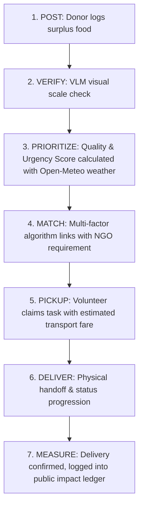

# 🍱 FoodBridge — AI-Assisted Surplus Food Redistribution Network

> **CIE Project Evaluation & Defense Guide**  
> *A unified coordination platform connecting food donors, NGOs, and volunteers using Vision AI, multi-factor matching, and live logistics tracking.*

---

## 🌟 1. Executive Summary & Problem Formulation

Every day, commercial establishments (hotels, catering banquet halls, college messes, tech park cafeterias, bakeries) generate surplus edible food that risks being wasted due to a **lack of fast, coordinated redistribution channels**. Simultaneously, local community shelters and orphanages face meal shortages, and willing student/community volunteers lack visibility on where pickup assistance is required.

**FoodBridge** solves this multi-agent coordination challenge by transforming static food donation into an intelligent, end-to-end redistribution pipeline:
- **Supply:** Commercial kitchens log surplus bulk food with photos and pickup deadlines.
- **Demand:** NGOs register meal requirements with dietary preferences and deadlines.
- **AI Verification:** Vision Language Model (VLM) audits image submissions for bulk/commercial containers.
- **Dynamic Prioritization:** Ambient weather decay + time urgency scoring engine.
- **Intelligent Matching:** Multi-factor algorithm pairing donors with the closest compatible NGO.
- **Volunteer Logistics:** Transparent distance-based transport estimation and delivery audit trail.
- **Measurable Impact:** Real-time metrics for kilograms rescued, meal equivalents, and avoided $\text{CO}_2\text{e}$ emissions.

---

## 🎯 2. The 7-Step Lifecycle Formula

$$\mathbf{POST} \longrightarrow \mathbf{VERIFY} \longrightarrow \mathbf{PRIORITIZE} \longrightarrow \mathbf{MATCH} \longrightarrow \mathbf{PICKUP} \longrightarrow \mathbf{DELIVER} \longrightarrow \mathbf{MEASURE}$$



1. **POST:** Donor logs surplus quantity (kg), category, pickup deadline, and food photo.
2. **VERIFY:** Ollama + LLaVA Vision Model performs preliminary bulk volume and packaging verification.
3. **PRIORITIZE:** Decay engine scores urgency ($0-100$) using remaining time, temperature, humidity, and food perishability.
4. **MATCH:** Intelligent matching ranks top NGO candidates using distance, meal coverage, and food type compatibility.
5. **PICKUP:** Volunteer accepts delivery mission, viewing distance and fair transport estimate ($\text{₹}$).
6. **DELIVER:** Real-time state machine: `ngo_accepted` $\rightarrow$ `volunteer_assigned` $\rightarrow$ `picked_up` $\rightarrow$ `delivered` $\rightarrow$ `confirmed`.
7. **MEASURE:** System records rescued kg, meal equivalents served, and carbon offset in the permanent audit trail.

---

## 🧮 3. Mathematical Models & Formulas

### A. Quality & Urgency Decay Score ($S$)
$$S = S_{\text{time}} + S_{\text{perishability}} + S_{\text{weather}} + S_{\text{quantity}} + S_{\text{freshness}}$$

| Component | Max Points | Description |
| :--- | :---: | :--- |
| **$S_{\text{time}}$** | $40$ | $\le 1\text{ hr} \implies 38\text{ pts}$, $1-2\text{ hrs} \implies 32\text{ pts}$, $2-4\text{ hrs} \implies 22\text{ pts}$, $>4\text{ hrs} \implies 15\text{ pts}$ |
| **$S_{\text{perishability}}$** | $25$ | Perishability weight: Cooked Meals ($1.0$), Dairy ($0.95$), Produce ($0.70$), Bakery ($0.60$), Packaged ($0.40$) |
| **$S_{\text{weather}}$** | $15$ | Real-time Open-Meteo temp ($T$) & humidity ($H$): Accelerated decay if $T > 28^\circ\text{C}$ and $H > 65\%$ |
| **$S_{\text{quantity}}$** | $10$ | Scaled by volume ($\ge 50\text{ kg} \implies 10\text{ pts}$, $\ge 25\text{ kg} \implies 8\text{ pts}$) |
| **$S_{\text{freshness}}$** | $10$ | Notes parsing for "warm", "refrigerated", "sealed", "prepared today" |

- **Urgency Thresholds:**
  - $S \ge 85 \implies$ **🔴 Urgent Rescue** (Critical pickup window)
  - $70 \le S < 85 \implies$ **🟠 High Priority**
  - $S < 70 \implies$ **🟢 Standard Window**

---

### B. Intelligent Multi-Factor Match Score ($\text{Match}_{\%}$)
$$\text{Match} = 0.35 \times S_{\text{dist}} + 0.25 \times S_{\text{type}} + 0.20 \times S_{\text{qty}} + 0.20 \times S_{\text{urgency}}$$

1. **Distance Proximity ($S_{\text{dist}}$):**
   Calculated using the **Haversine formula**:
   $$d = 2R \arcsin\left(\sqrt{\sin^2\left(\frac{\Delta\text{lat}}{2}\right) + \cos(\text{lat}_1)\cos(\text{lat}_2)\sin^2\left(\frac{\Delta\text{lon}}{2}\right)}\right)$$
   $\le 2\text{ km} \implies 100$, $2-5\text{ km} \implies 85$, $5-10\text{ km} \implies 65$, $>10\text{ km} \implies 40$.
2. **Food Type Compatibility ($S_{\text{type}}$):**
   Exact match ($100$), semantic cross-compatibility e.g. Bakery $\leftrightarrow$ Snacks ($90$), generic ($40$).
3. **Quantity Coverage ($S_{\text{qty}}$):**
   $$\text{Ratio} = \frac{\min(\text{Meals}_{\text{available}}, \text{Meals}_{\text{required}})}{\max(\text{Meals}_{\text{available}}, \text{Meals}_{\text{required}})}$$
   $\text{Ratio} \ge 0.75 \implies 100$, $\ge 0.50 \implies 85$, $\ge 0.30 \implies 65$.
4. **Urgency Weight ($S_{\text{urgency}}$):**
   Directly injected from the Quality/Urgency decay score.

---

### C. Logistics & Transport Estimation Model
$$\text{Fare}_{\text{INR}} = \text{Base Fare} + (\text{Distance}_{\text{km}} \times \text{Per-Km Rate})$$

| Cargo Weight | Recommended Vehicle | Base Fare ($\text{₹}$) | Per-Km Rate ($\text{₹/km}$) |
| :--- | :--- | :---: | :---: |
| $< 15\text{ kg}$ | 🚴 Bike / EV 2-Wheeler | $\text{₹}35$ | $\text{₹}10$ |
| $15 - 40\text{ kg}$ | 🛺 Auto-Rickshaw / EV Cargo | $\text{₹}55$ | $\text{₹}14$ |
| $> 40\text{ kg}$ | 🚐 Delivery Van / Mini Cargo | $\text{₹}120$ | $\text{₹}22$ |

*Zero-cost food philosophy: Food is 100% free. Transport is borne by the receiving NGO or volunteer.*

---

### D. Impact Conversion Factors
- **Meal-Equivalents:**
  - Cooked Meals: $1\text{ kg} \approx 3.0\text{ meals}$
  - Dairy Products: $1\text{ kg} \approx 4.0\text{ portions}$
  - Produce / Fruit: $1\text{ kg} \approx 2.5\text{ meals}$
  - Bakery: $1\text{ kg} \approx 3.0\text{ meals}$
- **Avoided Carbon Emissions:**
  - $\text{CO}_2\text{e Avoided} = \text{Quantity Rescued (kg)} \times 2.5\text{ kg CO}_2\text{e/kg}$ *(UNEP/FAO global average)*

---

## 🤖 4. AI / Vision Language Model (VLM) Architecture

### Role of Ollama + LLaVA
- **Prompt:** Instructs the VLM to analyze whether the uploaded photograph contains commercial catering containers (e.g. large stainless steel handis, chafing dishes, stacked bakery crates) vs. an individual leftover plate.
- **JSON Structured Output:**
  ```json
  {
    "is_bulk": true,
    "confidence": 0.94,
    "reason": "Commercial stainless steel buffet vessels and high portion volume detected.",
    "detected_items": ["Cooked Rice", "Dal", "Paneer Sabzi"],
    "packaging_type": "Insulated Stainless Steel Trays",
    "model_used": "Ollama/LLaVA (Vision-Language Model)"
  }
  ```
- **Fallback Resilience:** Hybrid heuristic fallback engine with PIL image analysis ensures **100% demo uptime** during presentations even if offline or on machines without high-end dedicated GPUs.

---

## 🏗️ 5. Technology Stack & Directory Structure

```
cie--project/
├── backend/
│   ├── app.py                # Main Flask REST API & Web Server
│   ├── database.py           # SQLite database schema, helpers & demo seed data
│   ├── vlm.py                # Vision-Language Model interface (Ollama/LLaVA + fallback)
│   ├── scoring.py            # Quality/urgency decay scoring & Open-Meteo weather
│   ├── matching.py           # Multi-factor matching algorithm
│   ├── transport.py          # Distance & transport pricing model
│   ├── requirements.txt      # Python dependencies
│   └── foodbridge.db         # SQLite persistent database file
├── frontend/
│   ├── index.html            # Unified Single Page Application (SPA)
│   ├── css/
│   │   └── style.css         # Modern glassmorphic responsive stylesheet
│   └── js/
│       ├── api.js            # API client & persona state manager
│       ├── map.js            # Leaflet.js interactive logistics map
│       ├── charts.js         # Chart.js impact visualizations
│       └── app.js            # Application controller & state machine transitions
├── uploads/                  # Uploaded food listing images
├── run.py                    # One-click launcher
└── README.md                 # Project documentation & presentation guide
```

---

## 🚀 6. How to Run the Project

### Quick Launch (One Command)
Open PowerShell / Terminal in the project root directory and run:

```bash
python run.py
```

This will automatically:
1. Initialize the SQLite database and seed realistic demo records for Bengaluru.
2. Launch the Flask REST backend at `http://127.0.0.1:5000`.
3. Open the web interface in your default browser.

---

## 🎓 7. CIE Faculty Viva & Defense Cheat Sheet

### Q1: Why is this an AI/ML project rather than a simple food donation website?
> **Answer:** "Static food donation websites fail because surplus food is perishable and time-sensitive. FoodBridge introduces three intelligent layers:
> 1. **Computer Vision (VLM):** Automated visual validation of bulk/commercial scale surplus containers to prevent spam or non-surplus submissions.
> 2. **Context-Aware Decay Scoring:** Combines real-time ambient weather (temperature and humidity from Open-Meteo) with remaining time and perishability to compute dynamic urgency scores.
> 3. **Multi-Factor Matching Engine:** Solves the bipartite matching problem between supply and demand using geospatial proximity, quantity coverage ratio, and priority weights."

### Q2: Can your AI certify that the food is 100% safe to eat?
> **Answer (Scientifically Defensible):** "No, and we explicitly do not claim bacteriological safety certification from a 2D image. Our VLM performs *preliminary visual verification* of portion scale, container types, and commercial packaging. Food handling safety remains a shared operational protocol with verified donors and authorized recipient NGOs."

### Q3: How do you prevent volunteers from claiming tasks and disappearing?
> **Answer:** "FoodBridge implements a 7-stage state machine audit trail: `available` $\rightarrow$ `ngo_accepted` $\rightarrow$ `volunteer_assigned` $\rightarrow$ `picked_up` $\rightarrow$ `delivered` $\rightarrow$ `confirmed`. Delivery is only recorded to the public impact ledger once the receiving NGO verifies receipt."

### Q4: What is your financial / operational model?
> **Answer:** "Surplus food is 100% free of cost. Transportation costs are estimated transparently based on distance and vehicle type, handled by the accepting NGO or volunteer. Long-term platform sustainability can be supported through CSR grants and institutional partnerships."

---

*Developed for CIE Academic Evaluation — FoodBridge Redistribution Network.*
